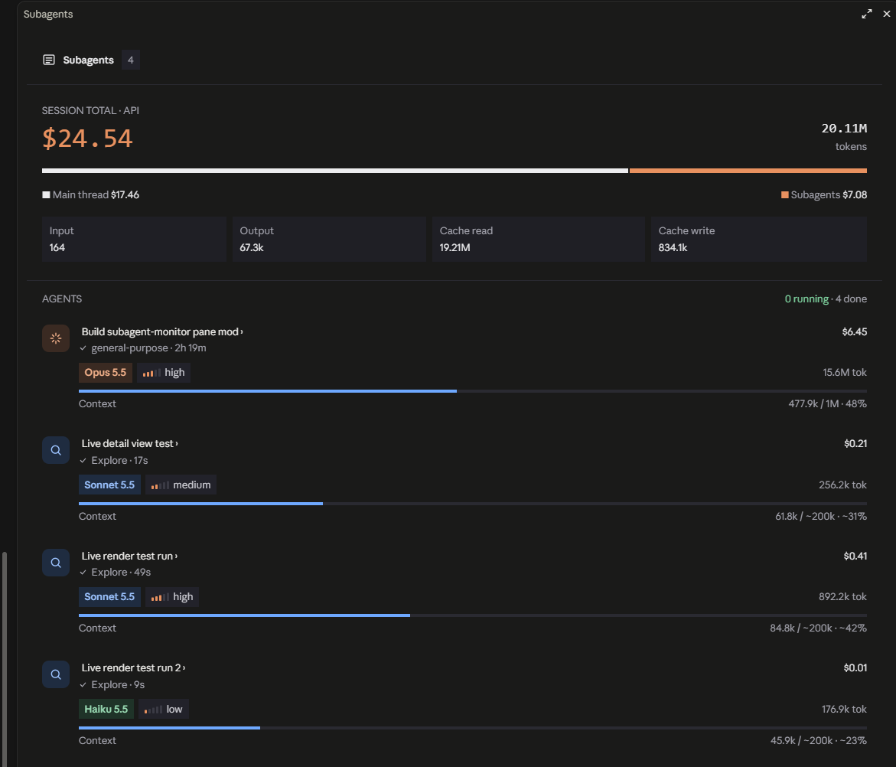

# subagent-monitor

A Claude Code mod that adds a live **Subagents** pane and a one-line band above the prompt.



- Session total at API prices, total tokens, main thread vs subagent cost split, and an input / output / cache read / cache write breakdown
- One row per subagent: task, type, status, elapsed time, model, effort, tokens, estimated cost and context fill
- Click a task title to open a detail view with the prompt, a live activity timeline and the final result
- Click the band, or run `/subagents`, to open or close the pane

## Install

At the prompt of a terminal Claude Code session:

```
/plugin install subagent-monitor --marketplace enginahmetbodur/subagent-monitor
```

Answer `y` to add the marketplace, then pick a scope (user scope loads it in every session, including the desktop app's local sessions).

To run from a local folder instead, set `CLAUDE_CODE_PLUGIN_DIRS` to this folder in the `env` block of `~/.claude/settings.json`.

## Notes

- Per-subagent cost is estimated from list prices. The session total comes from Claude Code itself.
- A subagent's context window is estimated unless it runs on the session's own model; estimates are shown with `~`.
- Session token totals count from the moment the mod loads.

## Develop

```
claude plugin validate .
claude plugin test .
```
